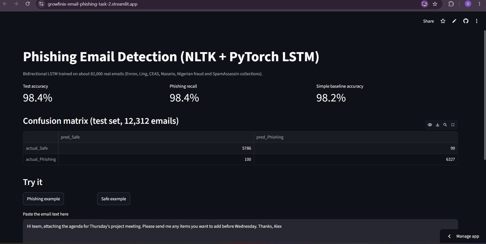
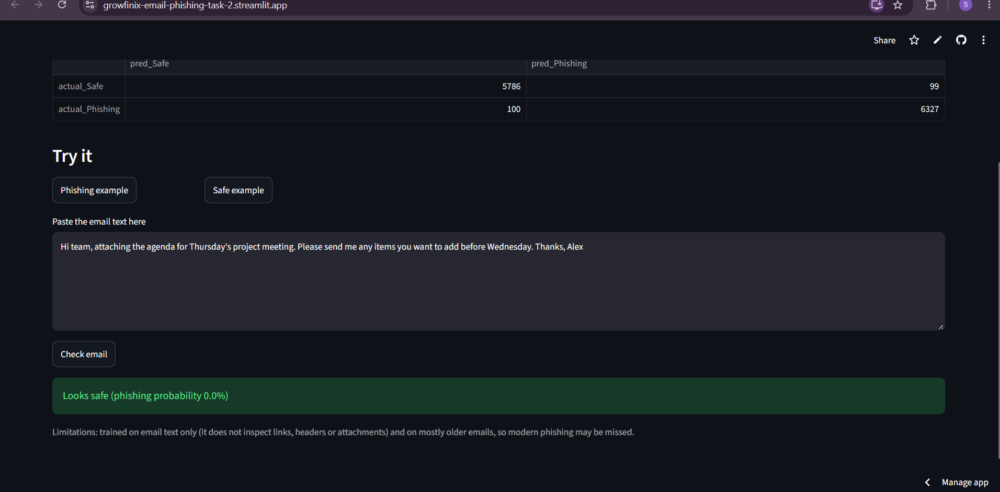
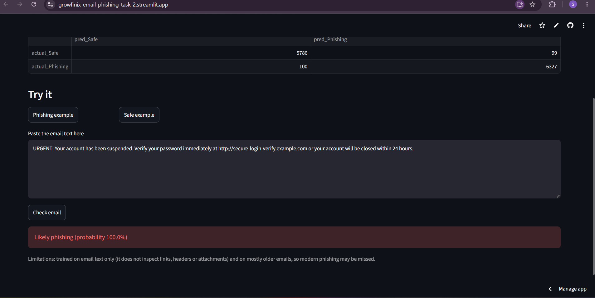

# Task 2: Spam and Phishing Email Detection (NLP)

**Live demo:** https://growfinix-email-phishing-task-2.streamlit.app/

Part of the Growfinix Technology Machine Learning Internship (Month 2).

Classifies email text as **Phishing** or **Safe** with a bidirectional LSTM (PyTorch), using NLTK for text preprocessing.

## Dataset
"Phishing Email Dataset" on Kaggle (naserabdullahalam), which merges the Enron, Ling, CEAS, Nazario, Nigerian-fraud and SpamAssassin email collections: 82,078 emails after removing exact duplicates (42,845 phishing/spam, 39,233 safe). Here the "phishing" label includes spam. Cite: Al-Subaiey et al. (2024), "Novel Interpretable and Robust Web-based AI Platform for Phishing Email Detection", https://arxiv.org/abs/2405.11619. The data is not stored in this repo: download it from Kaggle and unzip it into `data/` to retrain.

## Method
- Text is lowercased, URLs are replaced with a `urltoken` marker, tokens are extracted with NLTK's `RegexpTokenizer`, English stopwords are removed, and each email is cut to 200 tokens.
- Random stratified split (seed 42): 57,454 train, 12,312 validation, 12,312 test. The vocabulary (top 20,000 words) is built from the training set only.
- Model: embedding (64) -> bidirectional LSTM (64 units) -> dropout -> linear layer. Trained for 8 epochs with Adam, and the epoch with the best validation accuracy is kept. The test set is used once at the end.
- A simple baseline (TF-IDF + logistic regression) is trained for comparison.

## Results
Held-out test set (12,312 emails):

| Class | Precision | Recall | F1 | Emails |
|---|---|---|---|---|
| Safe | 0.9830 | 0.9832 | 0.9831 | 5885 |
| Phishing | 0.9846 | 0.9844 | 0.9845 | 6427 |

LSTM accuracy: 0.9838. TF-IDF + logistic regression baseline accuracy: 0.9818.

The confusion matrix is in `outputs/confusion_matrix.csv`.

## Limitations
- The LSTM beats the simple baseline by only a small margin, which suggests this dataset is relatively easy. It mixes sources with different writing styles, so part of the accuracy may come from source style and not only from phishing cues.
- The data is mostly older emails (for example Enron from the early 2000s), so modern phishing campaigns may be missed.
- The split is random, not time-based, and the model only reads email text. It does not inspect links, headers or attachments, and it cannot judge a bare link reliably.
- This is a learning project and not a production spam filter.

## Run it
Use Python 3.11.

    pip install -r requirements.txt
    python train_phishing.py
    streamlit run app.py

## Files
- `text_utils.py`: NLTK preprocessing
- `train_phishing.py`: training and evaluation
- `app.py`: Streamlit app
- `models/`: trained LSTM weights and vocabulary
- `outputs/`: test metrics and confusion matrix

## Screenshots

