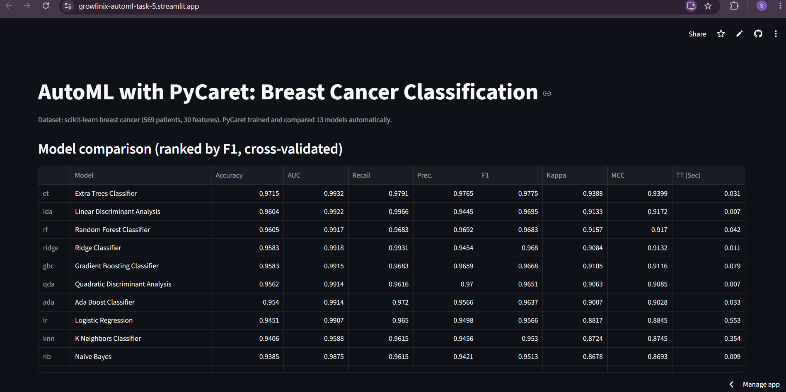
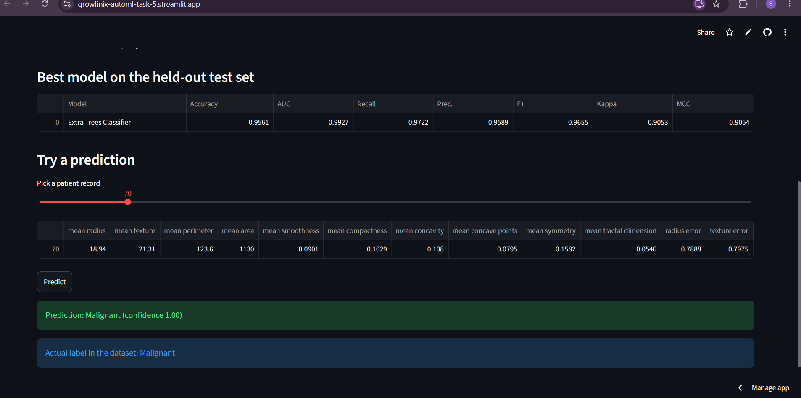
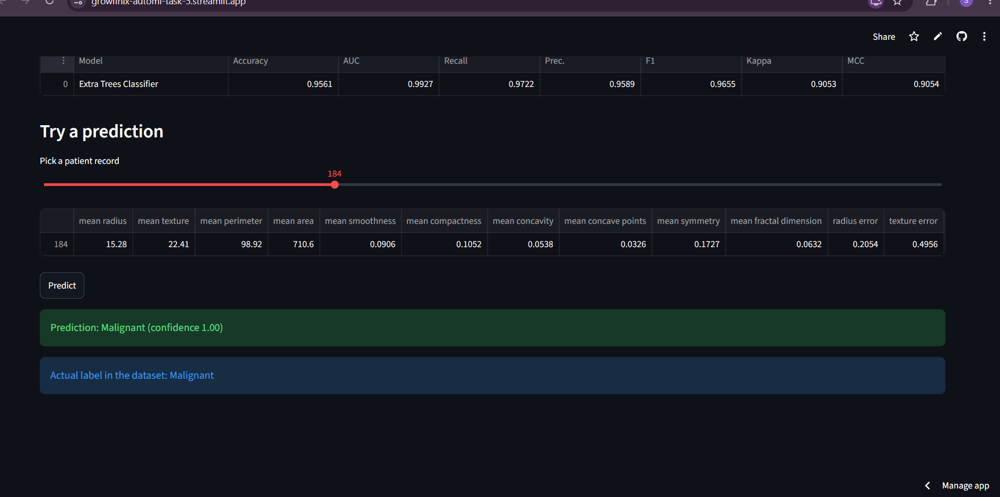

# Task 5: Automating Machine Learning (AutoML)

**Live demo:** https://growfinix-automl-task-5.streamlit.app/

Part of the Growfinix Technology Machine Learning Internship (Month 2).

This task uses PyCaret to train, evaluate and compare many classification models automatically, then picks the best one and serves it in a Streamlit app.

## Dataset
scikit-learn's built-in breast cancer dataset (Wisconsin Diagnostic): 569 patients, 30 numeric features, labels Malignant (0) or Benign (1). It loads with `load_breast_cancer()`, so nothing needs to be downloaded.

## Method
- `setup()` splits the data 80/20 (random seed 42) and builds the preprocessing pipeline.
- `compare_models(sort="F1")` trains and cross-validates 13 models and ranks them by F1.
- The best model is scored on the 20% held-out test set (114 patients).
- `finalize_model()` retrains the best model on all the data, and it is saved to `models/best_automl_model.pkl`.

## Results
Best model: Extra Trees Classifier.

| Metric | Held-out test set |
|---|---|
| Accuracy | 0.9561 |
| AUC | 0.9927 |
| Recall | 0.9722 |
| Precision | 0.9589 |
| F1 | 0.9655 |

The full cross-validated comparison is in `outputs/leaderboard.csv`, and the test-set scores are in `outputs/holdout_metrics.csv`.

## Limitations
- The dataset is small (569 rows), so the scores are good but not definitive.
- The saved model was retrained on all the data, so the test-set numbers above come from the model before finalizing.
- This is a learning project and not a medical tool.

## Run it
Use Python 3.11 (PyCaret does not support 3.12 or newer).

    pip install -r requirements.txt
    python train_automl.py
    streamlit run app.py

## Files
- `train_automl.py`: AutoML training script
- `app.py`: Streamlit app
- `models/`: saved model
- `outputs/`: leaderboard and test metrics

## Screenshots

